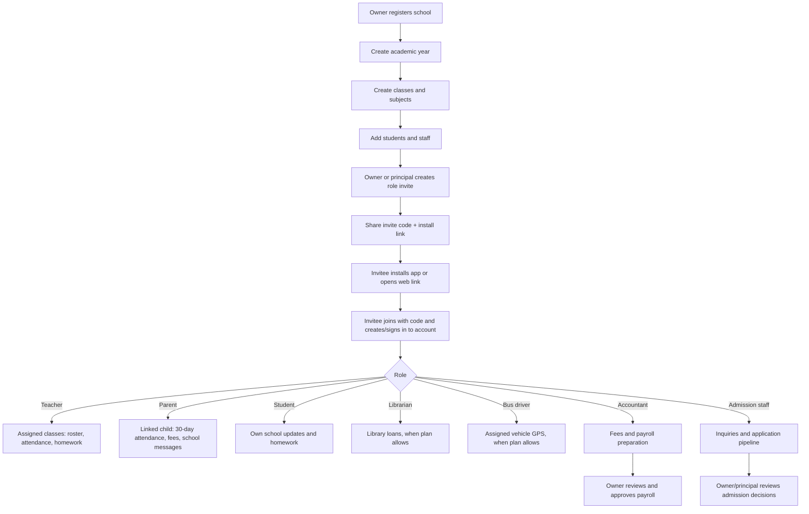
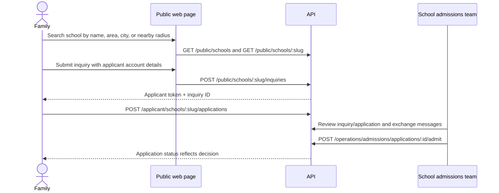

> **v1.4 runtime baseline:** Node.js 22.13+ is required.

# Developer workflow and role map

This guide shows how the intended core role flow fits together. The API is mounted under `/api`; use a member token from login in the `Authorization: Bearer <token>` header. Public routes don't need a token, while applicants use an applicant token. Do not share real access tokens.

## School setup and invitation diagram

The invite is tied to one school and one role. Parent/student invites also bind a student record. Invitation codes are hashed in the database, expire, and have a use limit. The response contains a one-time plaintext code so the owner can share it. Real push/SMS delivery of the link is a later integration.

## Public admissions flow

## Dashboard access by role

| Role | Intended access in this starter |
|---|---|
| Platform admin | Manage schools, subscription plans, support and school status across the platform |
| Owner | School profile, invites, members, academic year, classes, fee/payroll controls, activity, reviews, dashboard; final payroll approval |
| Principal | School operations, dashboard, reviews, and staff management within granted permission; cannot appoint another principal |
| Admission staff | Inquiry and application queue, messages and admission workflow |
| Accountant | Fee operations and payroll preparation; owner alone approves payroll |
| Teacher | Assigned classes/students only; attendance, homework, grading |
| Librarian | Library books and loans when plan includes library |
| Bus driver | Update assigned vehicle position when plan includes live GPS |
| Parent | Linked students only; 30-day attendance, notifications, consent and messaging |
| Student | Own records, homework and published results |
| Applicant | Own inquiries, applications and messages; no school membership until separately admitted/invited |

Role enforcement should be tested at the API, not only by hiding buttons in the interface.

## Main endpoint map

| Area | Representative routes |
|---|---|
| Registration/auth | `POST /auth/register-school`, `/auth/login`, `/auth/join`, `GET /auth/me`, `GET /auth/sessions`, `POST /auth/logout` |
| Public search | `GET /public/plans`, `GET /public/schools?name=&area=&city=`, optional `lat`, `lon`, `radiusKm`, and `GET /public/schools/:slug` |
| Applicant | `POST /public/schools/:slug/inquiries`, `POST /applicant/schools/:slug/applications`, `/applicant/inquiries`, `/applicant/applications` |
| School setup | `/school/profile`, `/school/invites`, `/school/academic-years`, `/school/classes`, `/school/students`, `/school/activity`, `/school/reviews` |
| Learning | `/learning/attendance/classes/:classId/:date`, `/learning/homework`, `/learning/me/children/:studentId/attendance/last-30-days` |
| Dashboard | `GET /school/dashboard/overview?academicYearId=` |
| Operations | `/operations/admissions`, `/operations/fees`, `/operations/payroll`, `/operations/library`, `/operations/exams`, `/operations/staff`, `/operations/transport`, `/operations/messages`, `/operations/support` |
| SMS consent/usage | `PUT /sms/me/consent`, `GET /sms/usage`, `POST /sms/attendance/:classId/:date` |
| Platform admin | `/platform/overview`, `/platform/schools`, `/platform/plans`, `/platform/support` |
| Payment webhook | `POST /webhooks/razorpay` (signature-verified webhook receiver) |

## Test cases to add before production

1. School A owner creates data; School B cannot read, mutate, or infer it by changing IDs.
2. Teacher can only see attendance, homework, and students for assigned classes.
3. Parent can only see children linked to their membership; another child's attendance returns 404/403.
4. Expired, revoked, exhausted, wrong-role, or already-used student invite cannot create membership.
5. Student or parent admission invite links only the intended student after account join.
6. Attendance date uses the school's configured timezone; future local dates reject, today is accepted, duplicate mark updates rather than duplicates.
7. Parent's date range is 30 calendar days; unrecorded is not silently counted as absence.
8. A plan with no library, payroll, fees, GPS, or SMS feature is denied by API regardless of UI.
9. SMS sends only with parent opt-in, a valid phone number, configured approved template, and remaining quota; provider failures don't count as delivered.
10. Razorpay order amount, school/fee charge, webhook signature, duplicate event, failed event, and captured event are reconciled idempotently.
11. Applicant can only read/send messages on their own inquiry and can't read school member records.
12. An accountant can prepare payroll but only owner can approve; owner activity is logged.
13. Public location search validates latitude, longitude and radius; results outside the radius are excluded and nearer schools sort first.
14. Reviews require active parent/student relationship, one review per reviewer/school, and moderation before becoming public.
15. Dashboard charts are scoped to selected school and academic year; no raw data from another tenant appears.

